# green-api-custom-notifier

[Green-API](https://green-api.com/en) is a service that lets you send and receive text, photos and videos through a stable WhatsApp API gateway. It includes a free account that can send notifications to 3 chats (group or private), among other features.

[green-api-custom-notifier](https://github.com/t0mer/green-api-custom-notifier) is a [Home Assistant](https://www.home-assistant.io/) custom notification component (installable through HACS) that sends notifications to WhatsApp contacts and groups using [Green-API](https://green-api.com/en).

## Table of contents

- [Features](#features)
- [Requirements](#requirements)
- [Limitations](#limitations)
- [Getting started](#getting-started)
  - [Set up a Green-API account](#set-up-a-green-api-account)
  - [Get the contacts and groups](#get-the-contacts-and-groups)
  - [Install the component](#install-the-component)
  - [Set up the notification in Home Assistant](#set-up-the-notification-in-home-assistant)
- [Configuration reference](#configuration-reference)
- [Sending a message](#sending-a-message)
  - [Optional: attach media to the message](#optional-attach-media-to-the-message)
  - [Automation example](#automation-example)
- [Troubleshooting](#troubleshooting)
- [Security notes](#security-notes)
- [Contributing](#contributing)
- [License](#license)

## Features

- `notify` platform named `greenapi`, configured in `configuration.yaml`; each entry creates a `notify.<name>` action.
- Sends text messages to a WhatsApp contact (`...@c.us`) or group (`...@g.us`).
- Optional default target in the configuration, which a `target` in the action call overrides. A list of targets sends the message to each of them.
- Optional `title`, sent in **bold** on the first line of the message.
- Sends a file (image, document, and so on) with the message as its caption. The file can be a local path, a `/local/...` path (your `config/www` folder), or an `http(s)` URL that Home Assistant downloads first (for example a Frigate snapshot). The file is uploaded to Green-API and then sent to the chat.
- Uses your instance's own Green-API hosts (for example `https://7105.api.greenapi.com`), with optional `api_url` / `media_url` overrides.
- Link previews are off by default and can be turned on per message.
- A literal `\n` in the message is turned into a line break.

## Requirements

- A running Home Assistant instance with access to the `config` folder (for `custom_components` and `configuration.yaml`).
- A [Green-API](https://green-api.com/en) account and an instance linked to a WhatsApp account (see below).
- Outbound internet access from Home Assistant to Green-API.
- The Python library [`whatsapp-api-client-python`](https://pypi.org/project/whatsapp-api-client-python/), which Home Assistant installs automatically from the component's `manifest.json`.

## Limitations

- The free account is limited to 3 chats (group or private). <!-- TODO: verify current Green-API free-plan limits -->
- Messages are sent from the WhatsApp account linked to Green-API. If that is your own number, WhatsApp treats the notification as a message to yourself and your phone shows **no alert**. Link a separate number (for example a cheap prepaid or eSIM number) to get real notifications.
- The component only sends messages. To react to incoming WhatsApp messages, set up a [Green-API webhook](https://green-api.com/en/docs/api/receiving/technology-webhook-endpoint/) that calls a Home Assistant [webhook trigger](https://www.home-assistant.io/docs/automation/trigger/#webhook-trigger).

## Getting started

### Set up a Green-API account

Navigate to [https://green-api.com/en](https://green-api.com/en) and register for a new account:
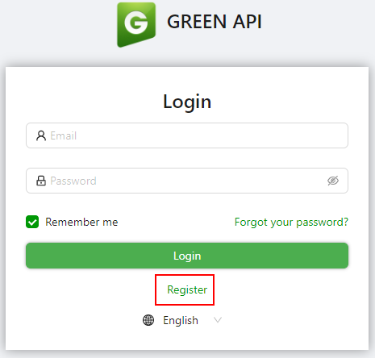

Fill in your details and click **Register**:
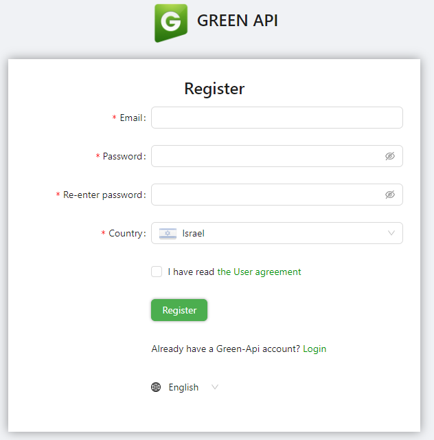

Next, click **Create an instance**:
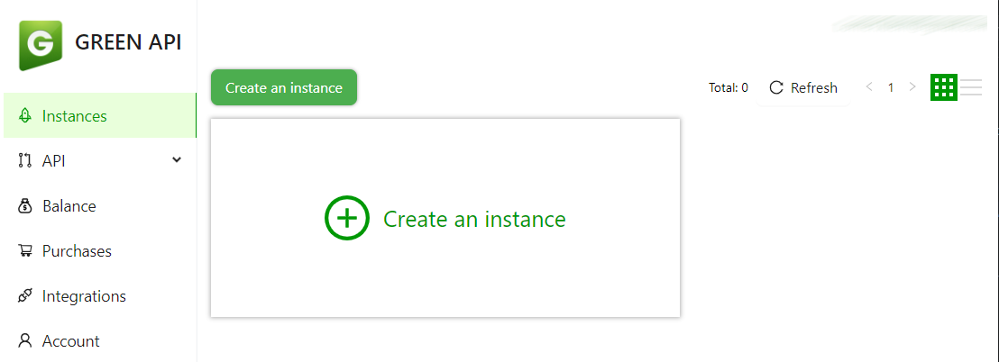

Select the **Developer** instance (free):
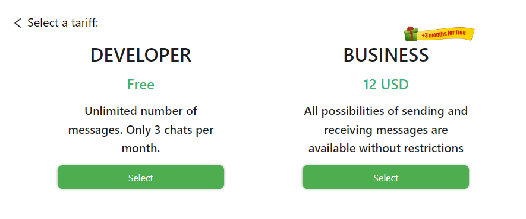

Copy the instance ID and token; you need them for the integration settings:
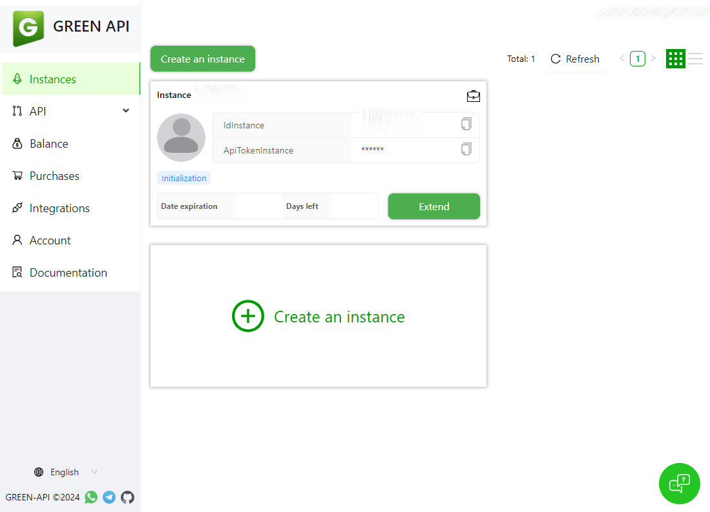

Next, connect your WhatsApp account to Green-API. On the left side, under **API** → **Account**, click **QR**, copy the QR URL into the browser and click **Scan QR code**:

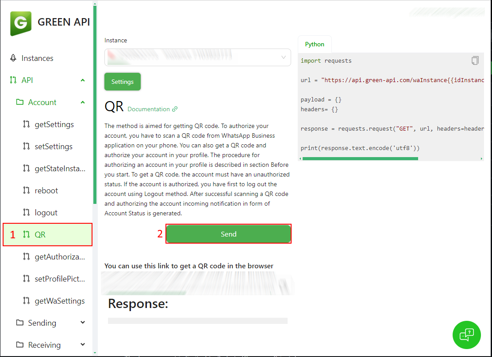

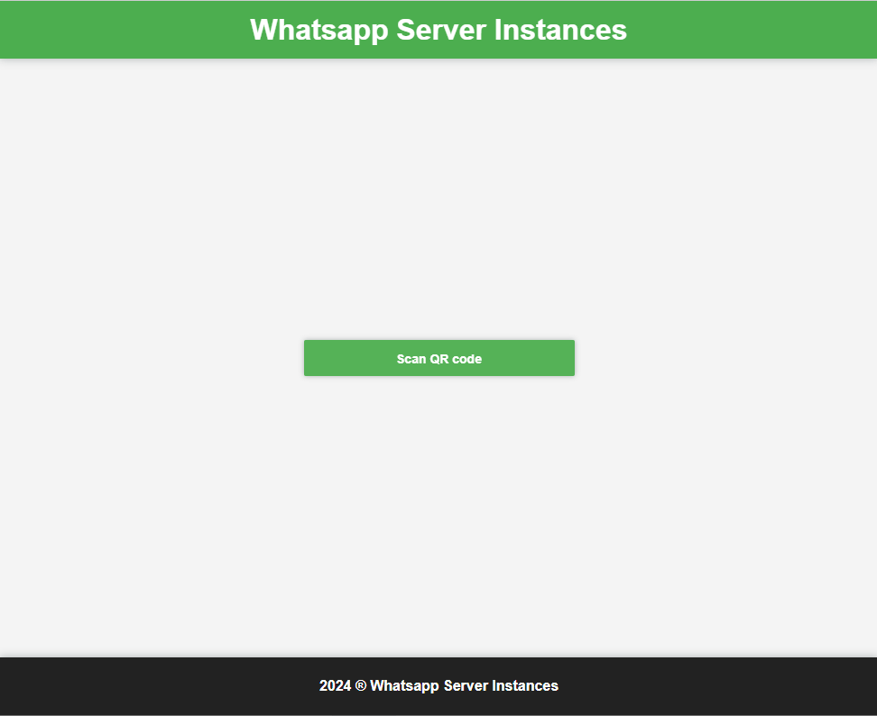

Scan the QR code with WhatsApp to link your account with Green-API:

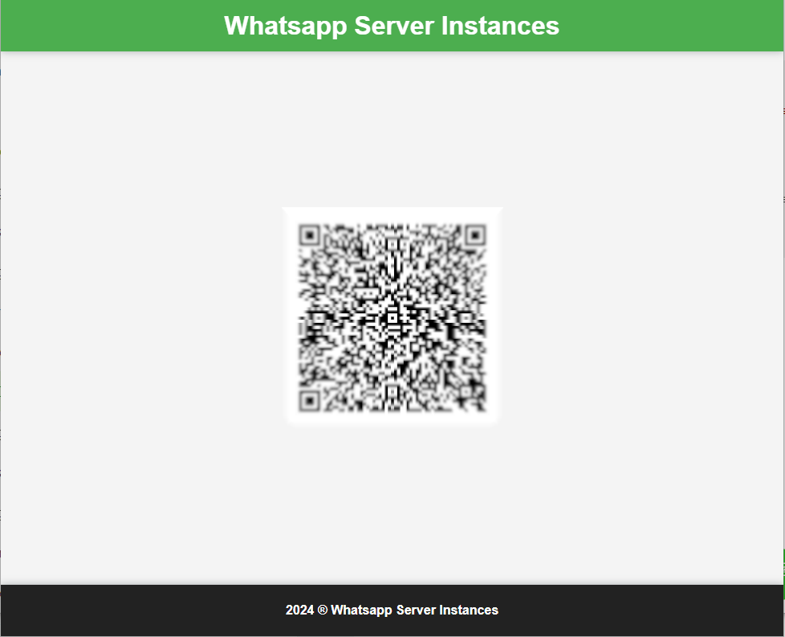

Once the account is linked, the green light in the instance header shows that the instance is active:
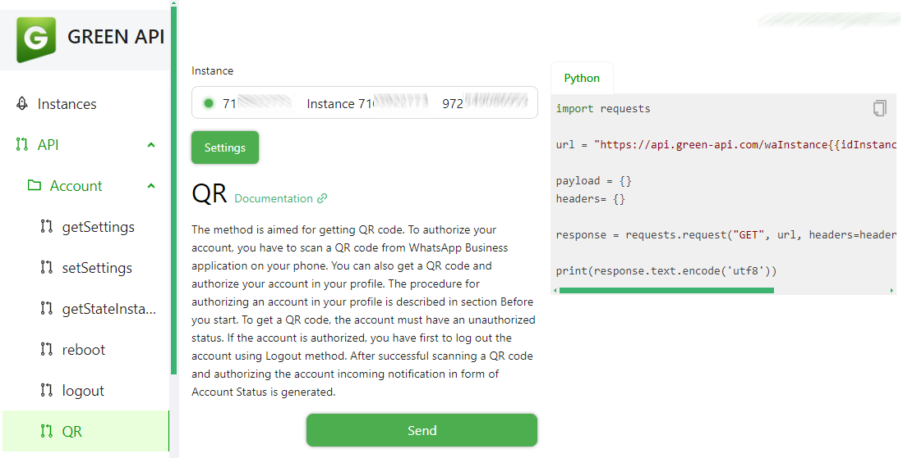

### Get the contacts and groups

Before you can start messaging, you need the contact or group ID. You can get it from a Green-API endpoint.
On the left side, under **API** → **Service methods**, click **getContacts** and then click **Send**:
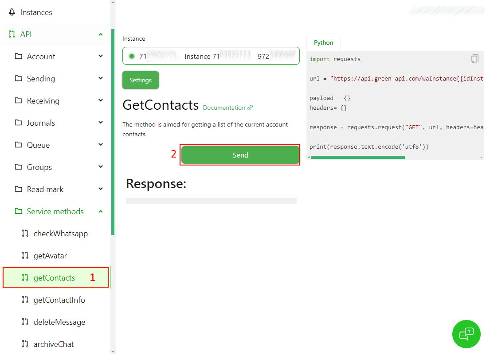

The result is the list of contacts and groups:
- A contact ID ends with **@c.us**.
- A group ID ends with **@g.us**.

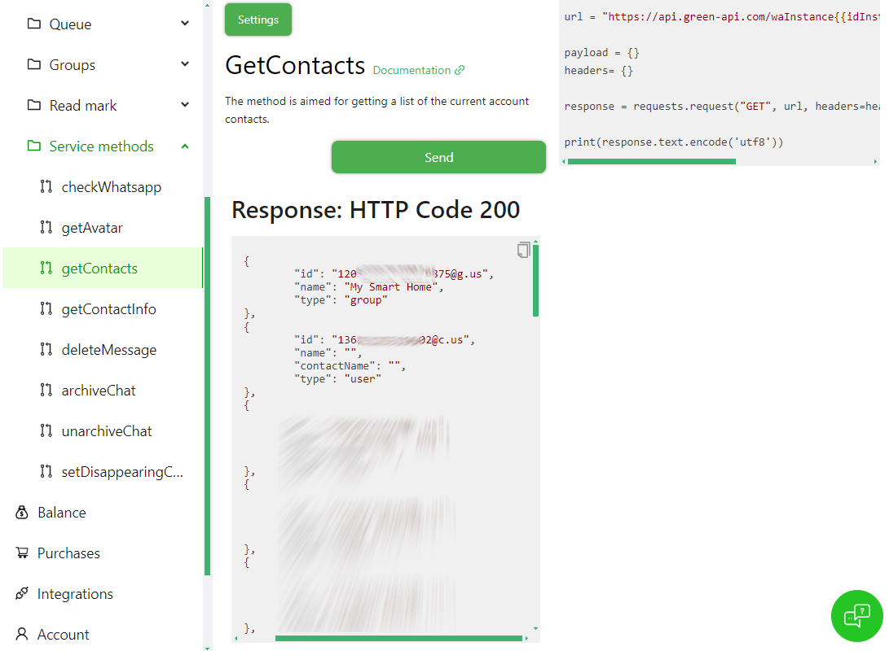

Write down the ID; you need it to configure the notification. The component sends the ID to Green-API exactly as written and does not add the `@c.us` / `@g.us` suffix for you, so always use the full ID.

### Install the component

**HACS (custom repository)**

1. In HACS, open the menu (⋮) → **Custom repositories**.
2. Add `https://github.com/t0mer/green-api-custom-notifier` with the category **Integration**.
3. Search for **WhatsApp Notifier (Green-API)** in HACS and download it.
4. Restart Home Assistant.

**Manual**

1. Download [green-api-custom-notifier](https://github.com/t0mer/green-api-custom-notifier).
2. Copy the `custom_components/greenapi` folder into your Home Assistant `config/custom_components` folder, so that you have `config/custom_components/greenapi/notify.py`.
3. Restart Home Assistant.

### Set up the notification in Home Assistant

This is a YAML-configured `notify` platform; there is no UI config flow. Add the following section to your `configuration.yaml` file and restart Home Assistant:

```yaml
notify:
  - platform: greenapi
    name: greenapi
    instance_id: !secret greenapi_instance_id  # REQUIRED: the Green-API instance ID
    token: !secret greenapi_token              # REQUIRED: the Green-API instance token
    target: 972*********@c.us                  # OPTIONAL: the default target. If you set it here, you don't have to specify it again in your action calls.
    # api_url: https://7105.api.greenapi.com   # OPTIONAL: only if the derived host is wrong (see below)
```

And in `secrets.yaml`:

```yaml
greenapi_instance_id: "1101000000"
greenapi_token: "your-green-api-token"
```

- `instance_id` is the Green-API instance ID.
- `token` is the Green-API instance token.
- `target` is the chat, contact or group ID to send the message to:
  - For groups, the ID must end with `@g.us`.
  - For chats, the ID must end with `@c.us`.

The component talks to your instance's own Green-API hosts, derived from the first four digits of the instance ID: instance `7105xxxxxx` uses `https://7105.api.greenapi.com` and `https://7105.media.greenapi.com`. Instances starting with `1101` use the generic `https://api.green-api.com` and `https://media.green-api.com`. If the **apiUrl** / **mediaUrl** shown in your Green-API console differ, set `api_url` (and `media_url` if needed).

The `name` sets the action name: `name: greenapi` creates `notify.greenapi`. You can add several entries with different names (for example, one per group).

## Configuration reference

| Key | Required | Default | Description |
|-----|----------|---------|-------------|
| `platform` | Yes | – | Must be `greenapi`. |
| `name` | No | `notify` | Name of the notify action (`notify.<name>`). Standard Home Assistant notify option. |
| `instance_id` | Yes | – | Green-API instance ID. |
| `token` | Yes | – | Green-API instance token. |
| `target` | No | – | Default chat ID (`...@c.us` for a contact, `...@g.us` for a group). Overridden by `target` in the action call. |
| `title` | No | – | Accepted by the schema but not used by the component; set `title` in the action call instead. |
| `api_url` | No | Derived from the instance ID | Green-API **apiUrl** from the console, e.g. `https://7105.api.greenapi.com`. |
| `media_url` | No | Derived from `api_url` (`api` → `media` in the host name) or the instance ID | Green-API **mediaUrl** from the console, used for file uploads. |

## Sending a message

To send a message, call the action and provide the following parameters:

- `message` (**required**): the text to send.
- `title` (**optional**): a title for the message, sent in **bold** on the first line.
- `target` (**optional** if you've defined a default target in the notify configuration, otherwise required): the chat or group ID to send the message to. If you pass a list, the message is sent to each ID.
- `data` (**optional**):
  - `file`: a file to attach (see below).
  - `link_preview`: `true` to show a preview of the first link in a text message (default `false`).

Line breaks: in YAML use a real line break (a `|` block) or `"\n"` in double quotes. A literal `\n` (as typed in the UI or in single quotes) is also turned into a line break.

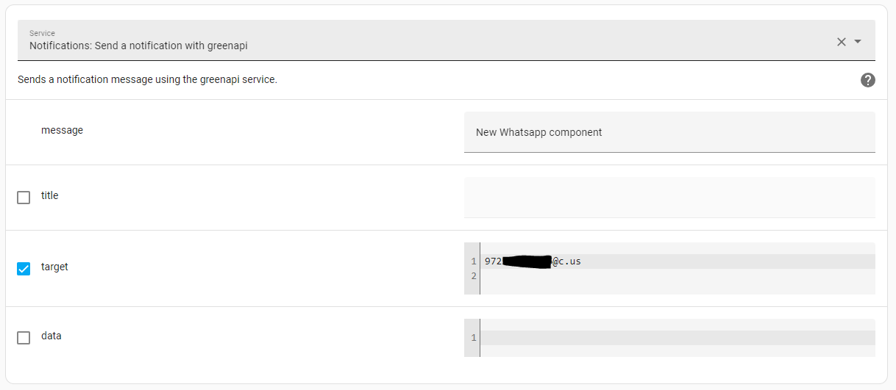

Or in YAML mode:

```yaml
action: notify.greenapi
data:
  message: New WhatsApp component
  title: Home Assistant
  target: 972*********@c.us
```

On Home Assistant versions older than 2024.8, use `service:` instead of `action:`.

### Optional: attach media to the message

To send a message with media, add the following to the `data` parameter:

- `file`: one of
  - a path to the file, as seen by Home Assistant (for example `/config/images/Capture.png`);
  - a `/local/...` path, which maps to your `config/www` folder (for example `/local/snapshots/door.jpg` → `/config/www/snapshots/door.jpg`);
  - an `http://` or `https://` URL. Home Assistant downloads the file first, so the URL only has to be reachable from Home Assistant (for example `http://frigate.local:5000/api/events/{{ id }}/snapshot.jpg`). For security, the URL must be listed in [`allowlist_external_urls`](https://www.home-assistant.io/integrations/homeassistant/#allowlist_external_urls), and redirects are not followed:

    ```yaml
    homeassistant:
      allowlist_external_urls:
        - http://frigate.local:5000/   # keep the trailing slash: the check is a prefix match
    ```

The file is uploaded to Green-API and sent to the chat, with the message (including the title, if any) as its caption.

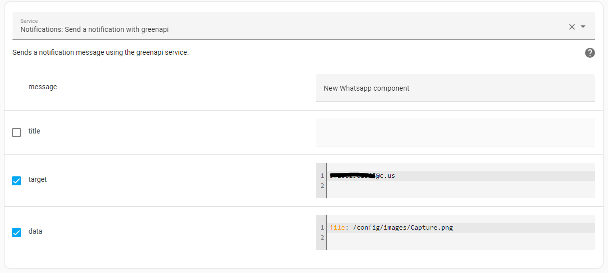

Or in YAML mode:

```yaml
action: notify.greenapi
data:
  message: New WhatsApp component
  target: 972*********@c.us
  data:
    file: /config/images/Capture.png
```

#### Important

If a local file does not exist, the message is still sent as plain text and a warning is logged. If a URL can't be downloaded, or Green-API rejects the upload, an error is logged and nothing is sent to that chat.

### Automation example

This example uses the `triggers:` / `trigger:` / `actions:` syntax, which needs Home Assistant 2024.10 or later. On older versions, use `trigger:` / `platform:` / `action:` with `service:`.

```yaml
automation:
  - alias: Notify WhatsApp group when the front door opens
    triggers:
      - trigger: state
        entity_id: binary_sensor.front_door
        to: "on"
    actions:
      - action: notify.greenapi
        data:
          title: Front door
          message: "The front door was opened at {{ now().strftime('%H:%M') }}"
          target: 120363000000000000@g.us
```

## Troubleshooting

- **No message arrives.** Check **Settings** → **System** → **Logs** for errors from `custom_components.greenapi.notify` and `whatsapp-api-client-python`. The component checks every Green-API response and logs the HTTP status and error text when a send fails.
- **`Connection timed out` / `Connection reset by peer` to `api.green-api.com` or `media.green-api.com`.** Your instance lives on another Green-API host, or your network blocks the generic host. Copy **apiUrl** and **mediaUrl** from the Green-API console into `api_url` and `media_url`.
- **Messages don't reach the chat.** Make sure the target is a full ID ending with `@c.us` or `@g.us`; the component does not add the suffix. Also check that the Green-API instance is active (green light) and still linked to WhatsApp.
- **The file is not sent.** A local path must exist inside the Home Assistant environment (for example under `/config`); in the UI, `/local/...` is mapped to `config/www`. A URL must be reachable from Home Assistant and listed in `allowlist_external_urls` (the log says so when it isn't).
- **No alert on your phone.** See [Limitations](#limitations): messages sent from your own number don't trigger a notification.
- **More logging.** To see the `Sending message to ...` log lines, enable info logging for the component:

  ```yaml
  logger:
    default: warning
    logs:
      custom_components.greenapi: info
      whatsapp-api-client-python: info
  ```

## Security notes

- The Green-API token gives full access to your linked WhatsApp account through Green-API. Keep it out of `configuration.yaml` by using `!secret` (as in the example above), and don't share `secrets.yaml`.
- Messages and files are sent through Green-API's cloud service, so they leave your network. Don't send anything you wouldn't trust to a third party.
- URL attachments are only downloaded from URLs in `allowlist_external_urls`, so an automation can't be used to fetch arbitrary internal addresses. Local file paths are read as-is, so only reference files you are happy to send.
- If a token leaks, regenerate it in the Green-API console and update `secrets.yaml`.

## Contributing

Issues and pull requests are welcome at [github.com/t0mer/green-api-custom-notifier](https://github.com/t0mer/green-api-custom-notifier/issues).

## License

This project is licensed under the [Apache License 2.0](LICENSE).
